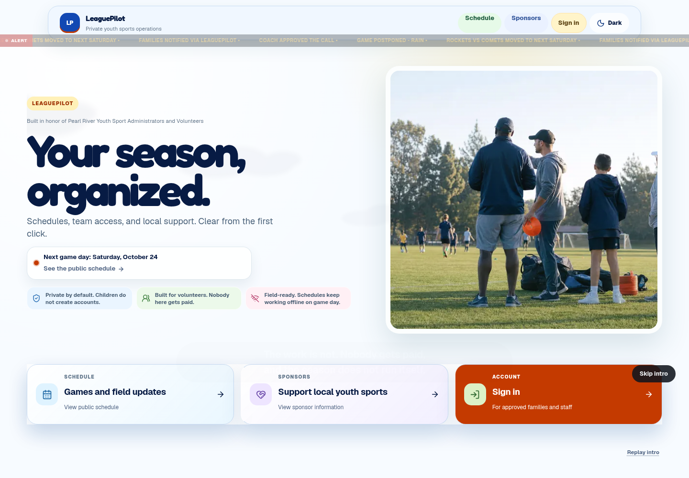
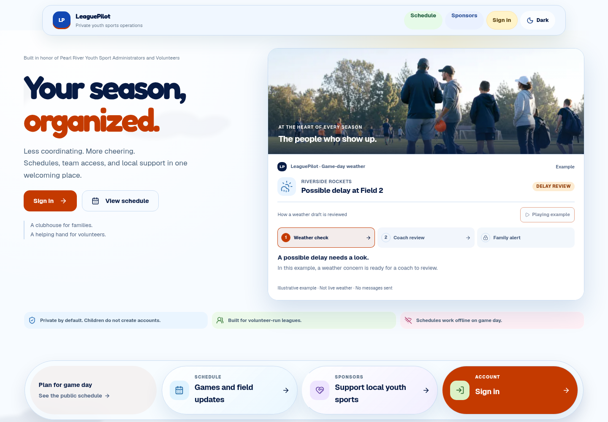
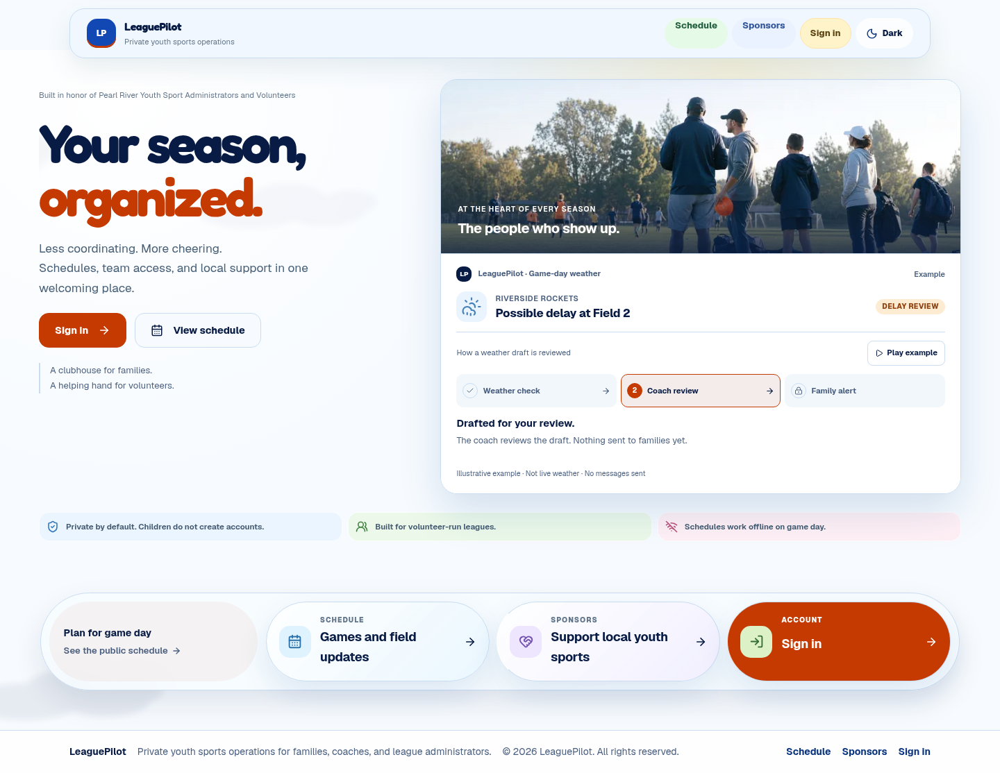
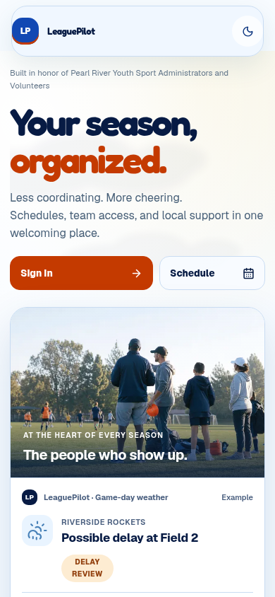

# Ready Board landing release

## Acceptance and authority

The owner accepted the rendered motion candidate on 2026-10-19: “like it in fact push that as the new landing”. This authorizes publication to the existing LeaguePilot repository and site. It establishes visual acceptance of the candidate; it is not participant usability, conversion, or broader product-readiness evidence.

The selected direction remains Organized Clubhouse / tactile and friendly / comfortable Ready Board. Mobile Sign in → Schedule remains the existing owner choice. The agent selected detailed composition and native motion under the owner's delegated visual and technology authority. [LP-UX-028](../../product-experience/leaguepilot/lp-ux-028-reference-motion-candidate.md) records reference transformations, handoffs, dependencies, task boundaries, and remaining audience assumptions.

## Bounded integration

The release starts from current `origin/main` at `36ed31e3a8e33717ea593400df6a7b6e51c9ed8d`. It transfers only the approved landing page, its presentation components and styles, the two public-header link classes needed by the approved mobile hierarchy, and evidence/documentation. It preserves main's security/dependency fixes and imports no registration, domain, database, provider, sponsorship, legal-content, or unrelated governance work from the candidate branch.

The candidate's inherited footer linked to `/privacy` and `/terms`, both observed returning 404 on production during release preparation. This release keeps the footer composition with existing Schedule, Sponsors, and Sign in destinations. It renders that footer only on `/`, avoiding a global public-route change.

## Validation and release dependencies

| Handoff | Dependency | Acceptance |
| --- | --- | --- |
| Candidate → release copy | Owner acceptance and current main | Landing-only extraction; existing main dependencies retained |
| Source → built candidate | Lockfile install, full tests, typecheck, lint, governance, production build | Local checks complete before publication; logs retained in task evidence |
| Release branch → main | Focused PR and exact-commit checks | CI and preview evidence reviewed before merge |
| Main → live domain | Existing Vercel Git project; production branch `main` | Exact main commit READY and actual landing/navigation/motion checked on `https://www.leaguepilot.us` |

Local source tests passed: 140 files, 885 tests. Typecheck and landing ESLint passed. Governance reported zero errors and one pre-existing product-direction contest warning. The lockfile remains unchanged; `npm audit` reports five high development-tool findings and no production or critical findings. The installed-skill check still reports missing `github` and `yeet` manifests; publication uses the installed authenticated Git/GitHub/Vercel tools with explicit paths and the `workflow-ship-change` procedure. No skill-installation or automated scope-guard enforcement is claimed.

Detailed machine logs, exact commit/deployment receipts, measured sizes, and final hosted captures are retained in the release worktree's `output/playwright/landing-release-20261019/`. Local evidence is not upgraded into hosted or production proof.

## Captures

Headless Chromium captures; mobile sizes are browser viewports, not physical-device tests.

### Before — production before publication, 1440 × 1000

### Key moment — illustrative weather check

### Result — built release candidate

## Proof boundaries and rollback

The page changes presentation and navigation entry points. The weather example reads no private record, approves no draft, and sends no message. Existing server-confirmed role routing remains in place. No migration, secret, provider gate, payment gate, or tenant policy changes.

The previous production deployment is `dpl_FQdA6WUvcgX4vSSmEPEw4VJEyoJK` at main commit `36ed31e3a8e33717ea593400df6a7b6e51c9ed8d`. If the new publication breaks the landing, the existing Vercel project can roll back to that deployment; source repair should proceed forward through main. No rollback is performed merely by recording this option.

Family-first audience priority, participant usability, assistive-technology evaluation, and measured conversion remain outstanding after publication. Public-page success does not close private-role or provider acceptance gates.
